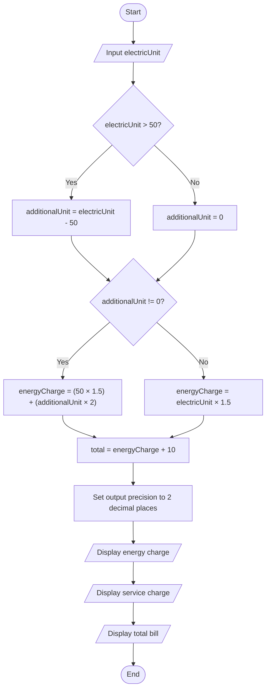
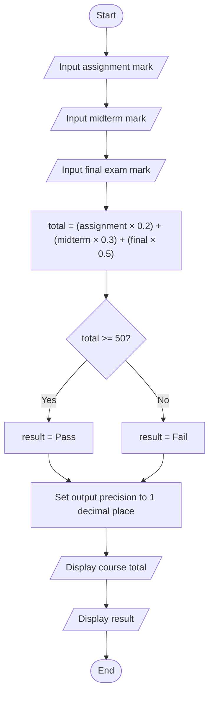
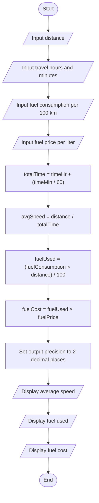

# C++ Assignment Flowcharts

This document contains the flowcharts for the three C++ programming assignments.

---

# 1. Electricity Bill Calculator

This flowchart illustrates the process of calculating an electricity bill based on the number of units consumed.

---

# 2. Student Course Total Calculator

This flowchart illustrates how the program calculates a student's weighted course total and determines whether the student passes or fails.

---

# 3. Trip Speed and Fuel Cost Calculator

This flowchart illustrates how the program calculates average speed, fuel consumption, and total fuel cost based on the trip information entered by the user.

